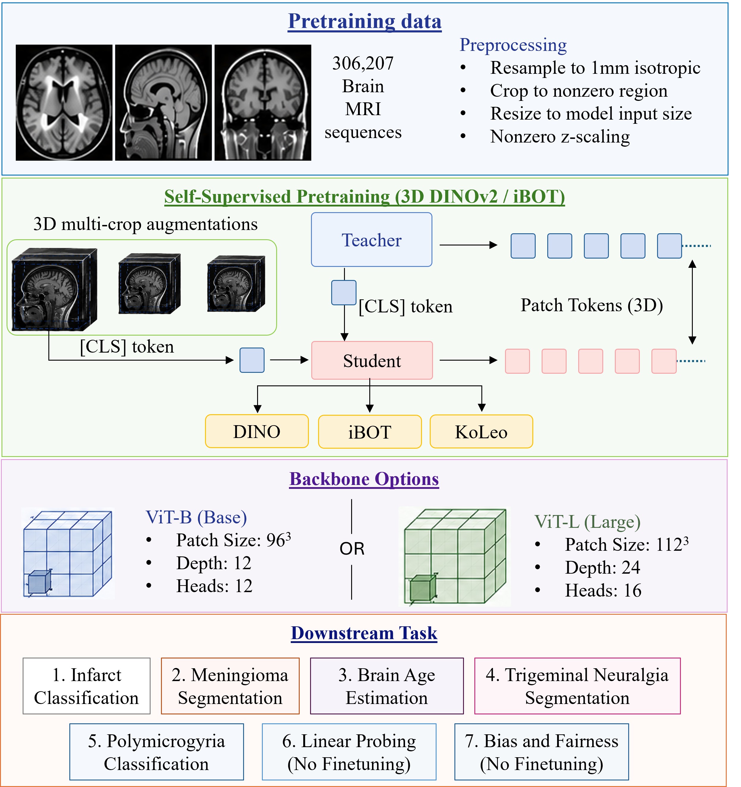

# FOMO26 — Brain MRI Foundation Model Challenge

<p align="center">
  
</p>

**Team: USSB** · MICCAI 2026

This repository contains our complete solution for the FOMO26 Challenge: self-supervised pretraining of 3D brain MRI foundation models on **FOMO300K** (306,207 scans, 58,741 subjects), followed by evaluation on 7 downstream tasks covering classification, segmentation, regression, and representation quality.

---

## Repository Layout

```
challenge/
├── pretraining/                  ← Self-supervised pretraining (3 model variants)
│   ├── train_dino3d.py           ← v1: MONAI ViT-B + BrainIAC warm-start
│   ├── train_dino3d_v2.py        ← v2: 3DINO ViT-L + 3DINO checkpoint warm-start
│   ├── train_dino3d_v3.py        ← v3: Custom 3D RoPE ViT (trains from scratch)
│   ├── slurm/                    ← HPC SLURM submission scripts
│   │   ├── a100_4gpu_48h_hpc.sh  ← v1: 1 node × 4 GPU
│   │   ├── train_dinov3_v2.sh    ← v2: 2 nodes × 4 GPU each
│   │   └── v3_3d.sh              ← v3: 2 nodes × 4 GPU each
│   └── requirements.txt
│
├── finetuning/                   ← Downstream task finetuning + inference
│   ├── src/
│   │   ├── backbone/
│   │   │   └── vit_wrapper.py    ← Unified v1/v2/v3 backbone loader
│   │   ├── models/
│   │   │   ├── lit_cls.py        ← Classification Lightning module (Tasks 1, 5)
│   │   │   ├── lit_reg.py        ← Regression Lightning module (Task 3)
│   │   │   ├── lit_seg.py        ← Segmentation Lightning module (Tasks 2, 4)
│   │   │   ├── lit_linear_probe.py ← Linear probe + embedding extraction (Tasks 6, 7)
│   │   │   └── seg_decoder.py    ← UNETR (v1) / PatchTokenDecoder (v2, v3)
│   │   ├── data/
│   │   │   ├── task_configs.py   ← Config dataclass for all 7 tasks
│   │   │   ├── dataset.py        ← NIfTI dataset + multi-sequence stacking
│   │   │   ├── transforms.py     ← MONAI pipelines (96³ for v1, 112³ for v2/v3)
│   │   │   └── preprocess/       ← Per-task preprocessing (fomo1–5.py)
│   │   ├── finetune.py           ← Unified finetuning entry point (Tasks 1–5)
│   │   ├── linear_probe.py       ← Linear probe entry point (Tasks 6–7)
│   │   ├── metrics.py            ← AUROC, DSC, NSD, MAE, Pearson, F1
│   │   └── inference/
│   │       ├── predict.py        ← Container entry point (dispatches per task)
│   │       ├── predict_task1.py  ← Infarct classification
│   │       ├── predict_task2.py  ← Meningioma segmentation
│   │       ├── predict_task3.py  ← Brain age regression
│   │       ├── predict_task4.py  ← Trigeminal neuralgia segmentation
│   │       ├── predict_task5.py  ← Polymicrogyria classification
│   │       ├── predict_task6.py  ← Linear probing
│   │       ├── predict_task7.py  ← Bias & fairness
│   │       └── apptainer.def     ← Submission container definition
│   └── requirements.txt
│
├── dinov3/                       ← DINOv3 package (loss, heads, RoPE) — cloned locally
├── 3DINO/                        ← 3DINO ViT-L architecture + pretrained checkpoint
├── BrainIAC/                     ← BrainIAC checkpoints + downstream reference code
├── fomo25/                       ← FOMO25 team reference code
└── baseline-codebase/            ← Organiser baseline (reference)
```

---

## Dependencies & Checkpoints

### Local repositories (already cloned — no additional cloning needed)

| Repo | Path | How used | pip install? |
|------|------|----------|-------------|
| `dinov3` | `dinov3/` | DINO losses, heads, RoPE layers | `pip install -e dinov3/` |
| `3DINO` | `3DINO/` | `DinoVisionTransformer3d` (v2 backbone) | No — `sys.path.insert()` |
| `BrainIAC` | `BrainIAC/` | Warm-start checkpoint for v1 pretraining only | No — checkpoint loaded directly |

`vit_wrapper.py` resolves all paths relative to the challenge root (`_CHALLENGE = Path(__file__).parents[3]`) and adds `3DINO/` and `pretraining/` to `sys.path` at import time.

### Checkpoint locations

| Checkpoint | Path | Used in |
|-----------|------|---------|
| BrainIAC SimCLR | `BrainIAC/src/checkpoints/brainiac.ckpt` | v1 pretraining warm-start |
| 3DINO ViT-L | `3DINO/3dino_vit_weights.pth` | v2 pretraining warm-start |
| DINO v1 output | `outputs/dino3d_a100/last.ckpt` | v1 finetuning / inference |
| DINO v2 output | `outputs/dino3d_v2/last.ckpt` | v2 finetuning / inference |
| DINO v3 output | `outputs/dino3d_v3/last.ckpt` | v3 finetuning / inference |

BrainIAC also ships task-specific checkpoints (brain age, IDH, segmentation, stroke, MCI) — useful as references but not used in our training pipeline.

---

## Downstream Tasks (FOMO26)

| # | Task | Type | Modalities | Metric | Support cases |
|---|------|------|-----------|--------|--------------|
| 1 | Infarct Classification | Few-shot binary cls | DWI, FLAIR, ADC, SWI | AUROC | 21 |
| 2 | Meningioma Segmentation | Few-shot binary seg | DWI, FLAIR, SWI | DSC + NSD | 23 |
| 3 | Brain Age Regression | Regression | T1, T2 | MAE + Pearson r | 200 |
| 4 | Trigeminal Neuralgia Seg | Multiclass seg | T2 | DSC + NSD | TBD |
| 5 | Polymicrogyria Classification | Few-shot binary cls | T1 | AUROC | TBD |
| 6 | Linear Probing | Rep. quality (frozen) | T1 | OvR AUROC + F1 | — |
| 7 | Bias & Fairness | Fairness (frozen) | T1 | OvR AUROC + F1 per group | — |

---

## Pretrained Backbone Models

Three backbone variants are pretrained on FOMO300K using DINOv2/v3-style losses (DINO CLS + iBOT patch + KoLeo entropy).

### v1 — MONAI ViT-B (BrainIAC warm-start)

| Property | Value |
|---|---|
| Architecture | MONAI ViT, 12 layers, 12 heads |
| Embed dim | 768 |
| Input | 96³ voxels, 16³ patches → 216 tokens |
| Position embedding | Learnable absolute (MONAI default) |
| Warm-start | BrainIAC SimCLR checkpoint |
| Effective batch | 16 × 4 GPU × 1 acc = **64** |
| Est. time/epoch | ~22 min on 4× A100-40GB |
| Environment | `envs_fomo` |

### v2 — 3DINO ViT-L (3DINO warm-start)

| Property | Value |
|---|---|
| Architecture | DinoVisionTransformer3d, 24 layers, 16 heads, block_chunks=4, init_values=1.0 |
| Embed dim | 1024 |
| Input | 112³ voxels, 16³ patches → 343 tokens |
| Position embedding | 3DINO relative position (from checkpoint) |
| Warm-start | 3DINO ViT-L checkpoint (`3dino_vit_weights.pth`) |
| Effective batch | 2 × 8 GPU × 4 acc = **64** |
| Est. time/epoch | ~30–35 min on 2 × 4 A100-40GB |
| Environment | `envs_fomo_v2` |

### v3 — 3D RoPE ViT (trains from scratch)

| Property | Value |
|---|---|
| Architecture | Custom ViT, 24 layers, 16 heads, head_dim=72 (72 % 6 = 0 ✓ for 3D RoPE) |
| Embed dim | 1152 |
| Input | 112³ voxels, 16³ patches → 343 spatial + 4 storage tokens |
| Position embedding | 3D Rotary Position Embedding (no learnable pos_embed) |
| Warm-start | None (trained from random init) |
| Effective batch | 12 × 8 GPU × 1 acc = **96** |
| Est. time/epoch | ~35–40 min on 2 × 4 A100-40GB |
| Environment | `envs_fomo_v2` |

---

## Environments

Three separate conda environments are used:

| Env name | Purpose |
|----------|---------|
| `envs_fomo` | v1 pretraining |
| `envs_fomo_v2` | v2 + v3 pretraining (same packages; v2 additionally needs 3DINO on PYTHONPATH) |
| `envs_fomo_finetune` | downstream finetuning + inference |

Exact exported environments (use these for reproducibility):

```bash
# Recreate from exported yml (preferred):
conda env create -f pretraining/environment_v1.yml   # → envs_fomo
conda env create -f pretraining/environment_v2.yml   # → envs_fomo_v2

# Or export from a working install:
conda env export -n envs_fomo    > pretraining/environment_v1.yml
conda env export -n envs_fomo_v2 > pretraining/environment_v2.yml
```

### Environment 1 — v1 Pretraining (`envs_fomo`)

```bash
module load conda
conda activate envs_fomo

export CHALLENGE=/N/project/histo-exp/challenge/fomo
export PYTHONPATH=$CHALLENGE:$CHALLENGE/dinov3:$PYTHONPATH
```

### Environment 2 — v2 + v3 Pretraining (`envs_fomo_v2`)

```bash
module load conda
conda activate envs_fomo_v2
pip install -e $CHALLENGE/dinov3/   # once, editable install of the dinov3 package

export CHALLENGE=/N/project/histo-exp/challenge/fomo
# v2 — needs 3DINO on path for DinoVisionTransformer3d:
export PYTHONPATH=$CHALLENGE:$CHALLENGE/dinov3:$CHALLENGE/3DINO:$PYTHONPATH
# v3 — 3DINO not needed:
export PYTHONPATH=$CHALLENGE:$CHALLENGE/dinov3:$PYTHONPATH
```

### Environment 3 — Finetuning + Inference (`envs_fomo_finetune`)

```bash
module load conda
conda activate envs_fomo_finetune
pip install -r finetuning/requirements.txt   # once

export CHALLENGE=/N/project/histo-exp/challenge/fomo
export PYTHONPATH=$CHALLENGE/finetuning/src:$CHALLENGE/pretraining:$CHALLENGE/dinov3:$CHALLENGE/3DINO:$PYTHONPATH
```

---

## Pretraining

### Quick Smoke Test (interactive node, 1 GPU)

```bash
# v1
torchrun --nproc_per_node=1 pretraining/train_dino3d.py \
    --data_dir $FOMO300K_DIR --output_dir /tmp/smoke_v1 \
    --brainiac_ckpt $BRAINIAC_CKPT --batch_size 16 --max_steps 5 --no_wandb

# v2
torchrun --nproc_per_node=1 pretraining/train_dino3d_v2.py \
    --data_dir $FOMO300K_DIR --output_dir /tmp/smoke_v2 \
    --pretrained $DINO3D_CKPT --batch_size 2 --max_steps 5 --no_wandb

# v3
torchrun --nproc_per_node=1 pretraining/train_dino3d_v3.py \
    --data_dir $FOMO300K_DIR --output_dir /tmp/smoke_v3 \
    --batch_size 1 --max_steps 5 --no_wandb
```

### Full HPC Training (SLURM)

```bash
# v1 — 1 node × 4 A100, ~37 h for 100 epochs
sbatch pretraining/slurm/a100_4gpu_48h_hpc.sh

# v2 — 2 nodes × 4 A100, ~50–58 h for 100 epochs (may need 2 × 48 h jobs)
sbatch pretraining/slurm/train_dinov3_v2.sh

# v3 — 2 nodes × 4 A100, ~58–67 h for 100 epochs (may need 2 × 48 h jobs)
sbatch pretraining/slurm/v3_3d.sh
```

**Checkpoint resume**: All scripts use `trainer.fit(..., ckpt_path="last")`. Lightning automatically resumes from `outputs/<version>/last.ckpt`. Re-submit the same SLURM script to continue.

### Memory & Throughput

| Version | batch/GPU | GPUs | grad_accum | Eff. batch | Mem/GPU |
|---------|-----------|------|-----------|-----------|---------|
| v1 | 16 | 4 | 1 | 64 | ~30 GB |
| v2 | 2 | 8 | 4 | 64 | ~27 GB |
| v3 | 12 | 8 | 1 | 96 | ~38 GB |

---

## Finetuning (Tasks 1–5)

### Step 1 — Preprocess

```bash
cd finetuning/src

python data/preprocess/run_preprocessing.py --task 1 \
    --raw_dir /data/raw/task1 --out_dir /data/preprocessed/task1

python data/preprocess/run_preprocessing.py --task 2 \
    --raw_dir /data/raw/task2 --out_dir /data/preprocessed/task2

python data/preprocess/run_preprocessing.py --task 3 \
    --raw_dir /data/raw/task3 --out_dir /data/preprocessed/task3

python data/preprocess/run_preprocessing.py --task 4 \
    --raw_dir /data/raw/task4 --out_dir /data/preprocessed/task4

python data/preprocess/run_preprocessing.py --task 5 \
    --raw_dir /data/raw/task5 --out_dir /data/preprocessed/task5
```

**Preprocessing pipeline** (per modality, per subject):
1. RAS reorientation
2. 1mm isotropic resampling (0.5mm for Task 4 — high-res T2w)
3. Volume-wise z-normalisation (non-zero brain voxels only)
4. Crop to non-zero bounding box
5. Save as `<sid>_image[_i].nii.gz` + `<sid>_label.[txt|nii.gz]`

### Step 2 — Finetune

```bash
cd finetuning/src

# Task 1 — Few-shot infarct classification (freeze encoder)
python finetune.py --task 1 --model v3 \
    --checkpoint /path/to/outputs/dino3d_v3/last.ckpt \
    --data_dir /data/preprocessed/task1 \
    --output_dir /models/task1_v3 \
    --freeze_encoder --epochs 200 --lr 1e-4

# Task 2 — Meningioma segmentation (full finetune)
python finetune.py --task 2 --model v3 \
    --checkpoint /path/to/outputs/dino3d_v3/last.ckpt \
    --data_dir /data/preprocessed/task2 \
    --output_dir /models/task2_v3 \
    --epochs 300

# Task 3 — Brain age (T1+T2, multi-sequence)
python finetune.py --task 3 --model v2 \
    --checkpoint /path/to/outputs/dino3d_v2/last.ckpt \
    --data_dir /data/preprocessed/task3 \
    --output_dir /models/task3_v2 \
    --epochs 500

# Task 4 — Trigeminal neuralgia multiclass segmentation
python finetune.py --task 4 --model v3 \
    --checkpoint /path/to/outputs/dino3d_v3/last.ckpt \
    --data_dir /data/preprocessed/task4 \
    --output_dir /models/task4_v3 \
    --epochs 300

# Task 5 — Polymicrogyria (few-shot, freeze encoder)
python finetune.py --task 5 --model v1 \
    --checkpoint /path/to/outputs/dino3d_a100/last.ckpt \
    --data_dir /data/preprocessed/task5 \
    --output_dir /models/task5_v1 \
    --freeze_encoder --epochs 200
```

### Head architecture per task type

| Task type | Input to head | Head |
|-----------|---------------|------|
| Classification (1, 5) | CLS token (B, D) — mean-pooled across sequences | LayerNorm → Dropout → Linear(D→D/2) → GELU → Linear(D/2→2) |
| Regression (3) | CLS token (B, D) — mean-pooled T1+T2 | LayerNorm → Dropout → Linear(D→D/2) → GELU → Linear(D/2→1) |
| Segmentation v1 (2, 4) | Full volume (B, 1, 96, 96, 96) | MONAI UNETR — ViT encoder + skip-connection CNN decoder |
| Segmentation v2/v3 (2, 4) | Patch tokens (B, N, D) | PatchTokenDecoder — reshape → 4× ConvTranspose3d → voxel logits |

---

## Linear Probing (Tasks 6 & 7)

The challenge forbids any backbone finetuning for Tasks 6 and 7. Only a single linear layer may be trained.

```bash
cd finetuning/src

# 1. Extract CLS embeddings (frozen backbone, one pass over all data)
python linear_probe.py extract \
    --model v3 --checkpoint /path/to/outputs/dino3d_v3/last.ckpt \
    --data_dir /data/preprocessed/task6 \
    --embed_dir /embeddings/task6_v3

# 2a. Task 6 — Train linear probe + evaluate (OvR AUROC + F1)
python linear_probe.py train \
    --task 6 --embed_dir /embeddings/task6_v3 \
    --output_dir /models/task6_v3

# 2b. Task 7 — Same, but with demographic group CSV for fairness breakdown
python linear_probe.py train \
    --task 7 --embed_dir /embeddings/task6_v3 \
    --group_csv /data/task7_groups.csv \
    --output_dir /models/task7_v3
```

The linear probe uses LBFGS optimisation on the cached embedding vectors — training takes seconds on CPU.

---

## Testing All Three Backbones

Run all three models on the same task and compare metrics:

```bash
for MODEL in v1 v2 v3; do
    if [ "$MODEL" = "v1" ]; then
        CKPT=$CHALLENGE/outputs/dino3d_a100/last.ckpt
    else
        CKPT=$CHALLENGE/outputs/dino3d_${MODEL}/last.ckpt
    fi
    python finetuning/src/finetune.py \
        --task 1 --model $MODEL --checkpoint $CKPT \
        --data_dir /data/preprocessed/task1 \
        --output_dir /models/task1_${MODEL} \
        --freeze_encoder --no_wandb
done
```

---

## Container Submission

### Build

```bash
cd challenge/
apptainer build fomo26.sif finetuning/src/inference/apptainer.def
```

### Test locally

```bash
apptainer run fomo26.sif \
    --task 1 --model v3 \
    --checkpoint /models/dino3d_v3/last.ckpt \
    --finetune_ckpt /models/task1_v3/last.ckpt \
    --input_dir /test/task1/input \
    --output_dir /test/task1/output
```

### Predicted output format

| Task | File | Content |
|------|------|---------|
| 1, 5 | `<subject_id>.txt` | Single float: P(positive class) in [0, 1] |
| 3 | `<subject_id>.txt` | Single float: predicted age in years |
| 2, 4 | `<subject_id>_pred.nii.gz` | Integer label map (0=bg, 1=class1, …) |
| 6, 7 | `<subject_id>.txt` | Space-separated class probabilities |

### Runtime (H100 80GB, 32 CPUs — 120 s/case limit)

| Backbone | Single case inference | Within limit? |
|---------|----------------------|---------------|
| v1 (96³) | ~2–3 s | ✓ |
| v2 (112³) | ~4–6 s | ✓ |
| v3 (112³) | ~4–6 s | ✓ |

---

## Key Design Decisions

**Three model variants** — Different inductive biases to ablate: v1 (absolute pos. embed + SimCLR init), v2 (3D relative pos. from 3DINO + warm-start), v3 (no pos. embed, 3D RoPE, trains from scratch). The FOMO26 unified leaderboard rewards generalisation across all 7 tasks.

**Unified backbone interface** — `ViTWrapper.encode(x)` returns `{"cls": (B,D), "patches": (B,N,D)}` for all three models. All downstream heads are backbone-agnostic.

**Multi-sequence handling** — Tasks 1–3 use multiple MRI sequences. Each sequence is encoded independently (single-channel backbone forward pass). CLS tokens are mean-pooled. This handles missing modalities gracefully and avoids retraining the backbone for multi-channel input.

**Segmentation decoder** — v1 uses MONAI UNETR (ViT + skip-connection CNN decoder) seeded from the BrainIAC checkpoint — the original BrainIAC paper used this exact setup. v2/v3 use `PatchTokenDecoder`: final patch tokens are reshaped to a 3D grid and upsampled via 4 transposed-convolution stages to full resolution.

**Linear probing** — Embeddings are extracted once (offline) and cached as `.npz`. The linear head is trained with LBFGS in seconds. This exactly matches the "no finetuning of backbone" constraint in Tasks 6–7.

---

## References

- **DINOv2**: Oquab et al. DINOv2: Learning Robust Visual Features without Supervision. TMLR 2024.
- **DINOv3**: Kakogeorgiou et al. DINOv3: Raising the bar on medical image pre-training. MICCAI 2024.
- **3DINO**: 3D Self-Supervised Pretraining for Brain MRI. MICCAI 2024.
- **BrainIAC**: Pérez García et al. A self-supervised framework for learning from clinical brain MRI. arXiv 2023.
- **iBOT**: Zhou et al. iBOT: Image BERT Pre-Training with Online Tokenizer. ICLR 2022.
- **UNETR**: Hatamizadeh et al. UNETR: Transformers for 3D Medical Image Segmentation. WACV 2022.
- **MONAI**: MONAI Consortium. Project MONAI. GitHub 2020.
- **FOMO25 Baseline**: Llambias et al. Yucca: A deep learning framework for medical image analysis. arXiv 2024.

---

## Citation

```bibtex
@InProceedings{InnShu_Scaling_MICCAISAT2026,
        author = { Innani, Shubham AND Pitarch-Abaigar, Carla AND Bakas, Spyridon},
        title = { { Scaling Native 3D Self-Supervised DINOv2 for Brain MRI Foundation Models } },
        booktitle = {Medical Image Computing and Computer Assisted Intervention -- MICCAI 2026 Workshops and Challenges},
        year = {2026},
        publisher = {Springer Nature Switzerland},
        volume = {LNCS 17254},
        month = {pending},
        page = {pending}
}
```
